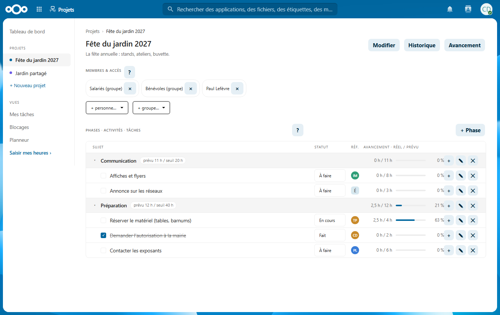
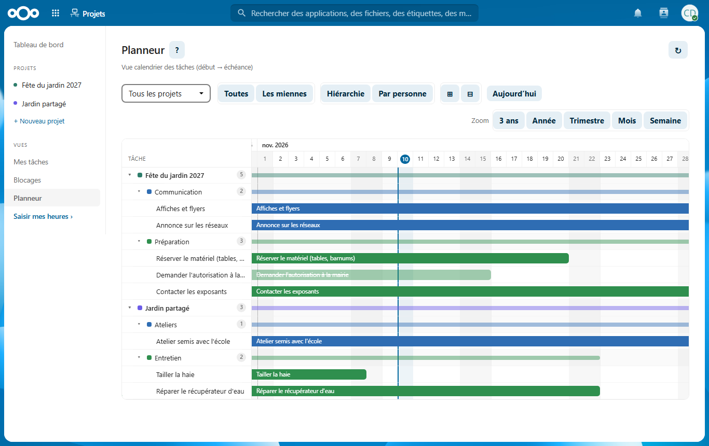
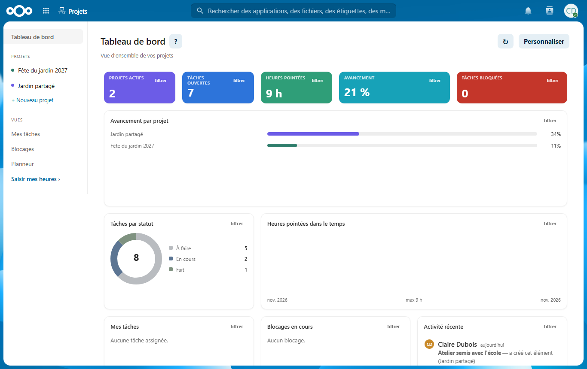
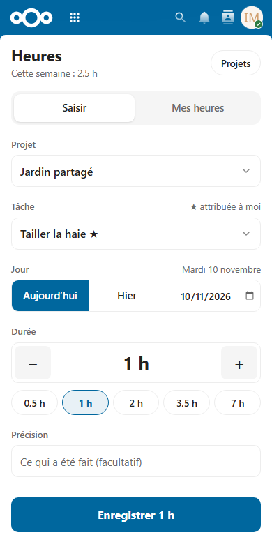

# Projets — suivre les projets et les heures d'une association, dans Nextcloud

Une appli [Nextcloud](https://nextcloud.com) pour les associations et petites structures qui
mènent des projets avec des salariés, des bénévoles et des partenaires extérieurs.



- **Des projets découpés** en phases, activités et tâches, avec des heures prévues.
- **Chacun voit ses projets** : la direction voit tout ; les autres ne voient que les projets
  dont ils sont membres (directement ou par un groupe Nextcloud).
- **Le pointage des heures**, pensé pour le téléphone : deux touches et c'est noté.
- **L'avancement** réel / prévu par tâche, activité et projet, avec un seuil d'alerte.
- **Un planneur** (vue calendrier), une vue « Mes tâches », les blocages signalés.
- **Un tableau de bord** personnalisable, et un widget pour l'accueil de Nextcloud.
- **Une administration** pour la direction : heures par personne, par équipe, export Excel.

| Planneur | Tableau de bord | Pointer ses heures |
|---|---|---|
|  |  |  |

## Essayer en 5 minutes

Avec Docker :

```bash
git clone https://github.com/King4Kats/projets-nextcloud.git
cd projets-nextcloud
docker compose up --build
```

Puis http://localhost:8160/apps/temonia_saisie/ — comptes fictifs `claire` (direction),
`thomas` (salarié), `ines` (bénévole), `paul` et `marie` (partenaires), mot de passe `projets2026`.
Détails dans [Démarrer](docs/01-demarrer.md).

## Documentation

1. [Démarrer](docs/01-demarrer.md) : la démo, les comptes, installer sur un vrai Nextcloud.
2. [Architecture](docs/02-architecture.md) : les deux applis, le chemin d'une requête, les données (schémas).
3. [Droits](docs/03-droits.md) : qui voit quels projets, qui peut faire quoi.
4. [API](docs/04-api.md) : toutes les adresses.
5. [Développer](docs/05-developper.md) : d'où vient le code, la boucle de travail, les tests.

Le code est commenté en français, paragraphe par paragraphe.

## Compatibilité

Nextcloud 29 à 34 · PHP 8.1+ · rien à compiler.

## Pourquoi « temonia_… » ?

L'appli est née pour l'association Témonia, qui l'utilise tous les jours. Ses identifiants
techniques (`temonia_pilotage`, `temonia_saisie`) sont restés : les changer casserait les
installations existantes. Tout ce qui s'affiche (nom de la structure, « Partenaires »…) se règle,
voir [Démarrer](docs/01-demarrer.md#réglages).

## Licence

[AGPL-3.0-or-later](LICENSE), comme Nextcloud.
